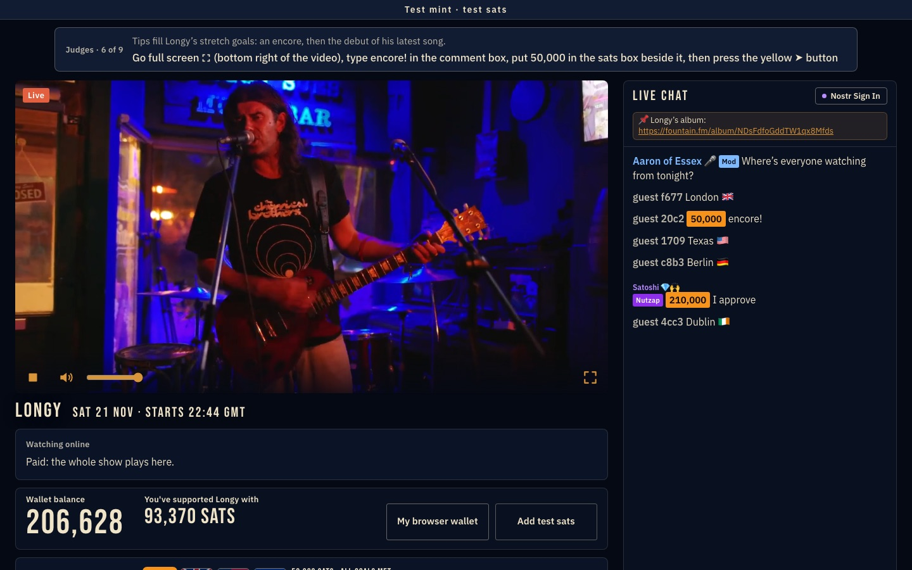
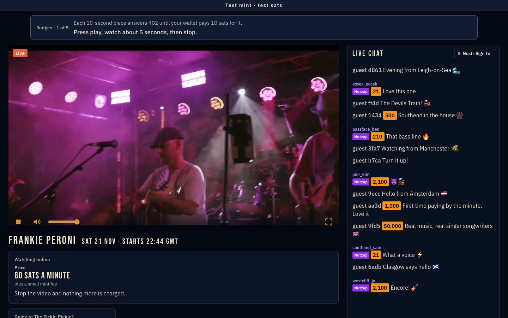
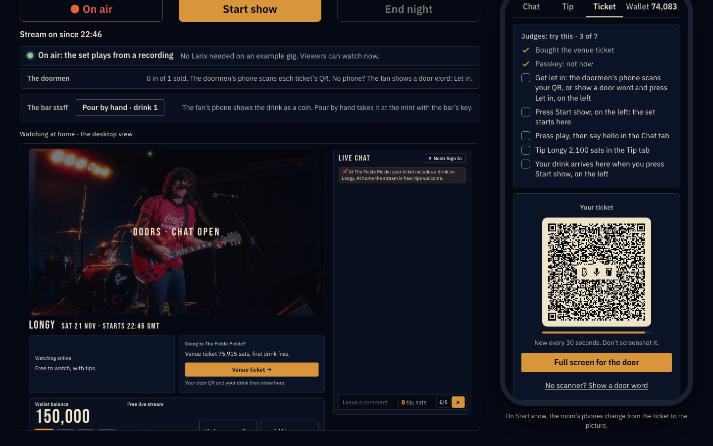
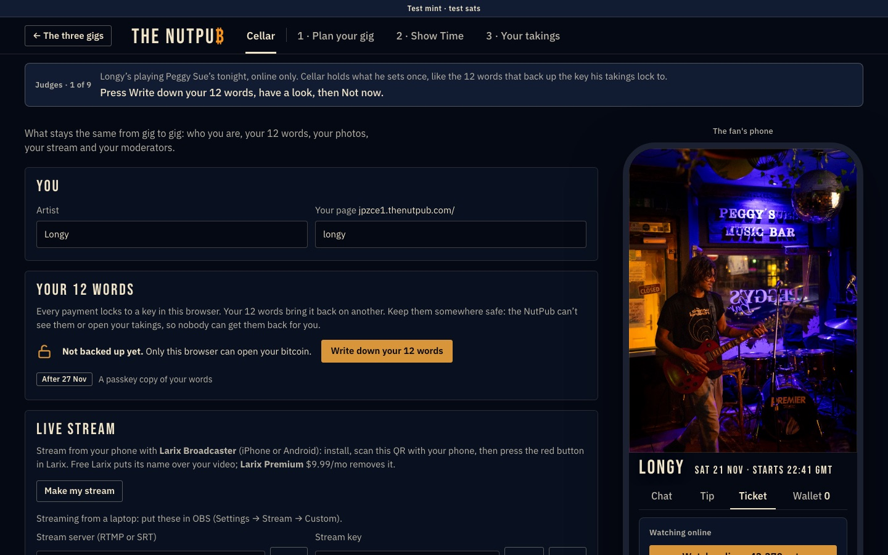
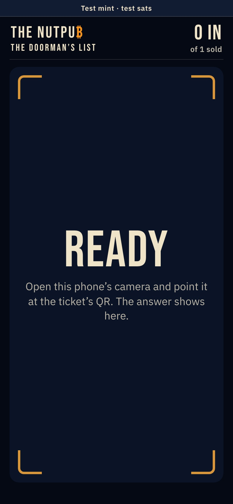

# The NutPub

**Live music paid in Cashu ecash: tickets, the door, the bar, the stream and tips, each an HTTP 402, from a wallet in the browser. No app, no account.**

## Try it

1. Open **[thenutpub.com](https://thenutpub.com)** on a laptop. A phone helps in gig 3, but isn't needed.
2. Make your artist passkey (or press Not now), then **Start Longy's gig**. You're Longy and one of his fans, in two tabs; test sats are already in the wallet. The passkey opens all three gigs on another laptop: **Back to your gigs**.
3. Follow the **Judges** line at the top of each page. Then gigs 2 and 3.

Test mint, test sats: they have no value. I'm one person, building this with Anthropic's Claude as my coding agent. A [Refueler Labs](https://refueler.io) project, entered in [NutNovember](https://nutnovember.org) 2026.

---

## The three gigs

Each poster on the home page opens a practice stage of its own (`<id>.thenutpub.com`), as the artist. The **Judges** line tells one line of the story and the one thing to do next; you press the artist's own buttons. Run them in order.

| | Gig | You'll see | Device |
|---|---|---|---|
| 1 | **Longy, online** | Cellar and the 12 words, a £20 Watch online ticket (one 402), a tip with a comment that meets both stretch goals, Pub TV | Laptop |
| 2 | **Frankie Peroni, pay as you watch** | 60 sats a minute: each 10-second piece answers 402 until the browser wallet pays for it. Stop and nothing more is charged. Then the fan's leftover sats go home | Laptop |
| 3 | **Longy at The Fickle Pickle** | A £35 venue ticket, blind-signed, with a free drink; a 30-second door QR; your phone as the Doorman's List; the drink handed over as an animated QR | Laptop, phone optional |

Every gig ends on **Your takings**: the night's earnings move to [Cashu.me](https://cashu.me) in one tap, then **Finish gig**. No phone? Every phone step has a laptop button. The demo never uses the laptop's camera.

**Gig 1:** the fan's page after the 50,000-sat encore tip, both goals met.


**Gig 2:** Frankie playing, paid for piece by piece.


**Gig 3:** Show Time, with the fan's phone holding the door QR. It changes every 30 seconds.


**Cellar:** what an artist sets once: name and page, the 12 words, photos, the stream.




**The Doorman's List:** any phone becomes the door scanner. It knows a ticket is real and unused, never who bought it.

Everything the NutPub does, ticked off with its specs, is on [The Kitchen](https://thenutpub.com/kitchen). The [Pub Noticeboard](https://thenutpub.com/noticeboard) shows a ticket bought by a script.

<br clear="right">

---

## An agent buys a ticket

Every price is a plain HTTP 402, so a script can pay one as well as a browser. This one buys gig 1's Watch online ticket with test ecash. Start gig 1 first; your stage's address is in the address bar. Needs Node.js 22 or later.

```bash
git clone https://github.com/rajesh-taylor/nutpub && cd nutpub && npm install
npm run agent -- https://<your stage>.thenutpub.com
```

A fresh run, 21 Nov 2026:

```
The NutPub · an agent buys a ticket · test sats, no account

1  A place in the show      POST /api/pass                → pass f1d5…27
2  Ask for the ticket       GET  /api/door/ticket?as=home  → 402 Payment Required
   Longy, Watch online (£20): 43,370 sats · mint testnut.cashu.space
   X-Cashu carries the bill (NUT-18), to be locked to the artist's key 02bb…4e (NUT-11)
3  Test sats from the mint  NUT-04: a quote, paid by the test mint → 43,402 sats
4  Lock them to the artist  NUT-03 swap into P2PK coins · mint fee 1 sat
5  Pay                      GET  again, X-Cashu: cashuB…   → 200 {"in":true}

✓ Bought: Longy, Watch online (£20), in 4.6 s. Nothing kept on this computer.
  On your stage, after End night: Your takings counts it under Tickets. (31 sats of test change left behind.)
```

The script is [`scripts/agent.js`](scripts/agent.js).

---

## How it works

Every price is an HTTP **402 Payment Required** (NUT-24). The browser wallet answers with ecash **locked to the recipient's public key** (NUT-11): the artist for tickets, minutes and tips; the bar for the drink. The artist's keys are made in the artist's own browser.

| Spec | Used for |
|---|---|
| NUT-00 to 04 | Ecash; test sats; the blind-signed venue ticket |
| NUT-07 | Whether a coin is spent (each payment, the poured drink) |
| NUT-10 · NUT-11 | Locking each payment to its owner |
| NUT-12 | The gig's proof that it signed the ticket |
| NUT-16 *(proposed)* | Animated QR codes: the drink handed over as the coin itself |
| NUT-18 | Payment requests |
| NUT-24 | HTTP 402: tickets, each minute of video, tips, replays |
| NIP-07 · 46 · 44 · 98 | Nostr sign-in, from an extension or a signer app |
| NIP-61 | Nutzaps |
| BIP-39 · BIP-32 | The artist's 12 words |
| Ed25519 · HKDF-SHA256 | The 12 words win a gig back after a lost or stolen device |

Built on [Coco](https://github.com/cashubtc/coco) and [cashu-ts](https://github.com/cashubtc/cashu-ts). The NUT-16 encoder is cashu-ts's own, copied unchanged from pull request [#1309](https://github.com/cashubtc/cashu-ts/pull/1309) into `vendor/cashu-ts-nut16`, with the spec's test vectors as tests.

```
client/    browser code: the fan's page, Show Time, wallets, NUT-16 QR
public/    pages, styles, fonts, the Judges line
server/    the Worker: tickets, the door, the 402 gate, replays, takings, stages
scripts/   the agent that buys a ticket, set-up helpers
test/      node:test suites (including the NUT-00, NUT-12, NUT-16, BIP-39 and RFC 6238 vectors)
vendor/    cashu-ts's NUT-16 encoder, unchanged
```

---

## Run it yourself

It runs on a Cloudflare Worker (free plan). Each practice stage is a SQLite Durable Object and the main site uses D1. Video runs on Cloudflare Stream. There's no mint of its own: the demo uses the public test mint. Requires Node.js 22 or later and a Cloudflare account.

```bash
npm install
npx wrangler d1 execute nutpub --remote --file schema.sql   # after creating the D1 database and KV namespace (ids in wrangler.jsonc)
npm test
npm start                                                     # http://localhost:8787
npm run deploy
```

- **Media:** the example clips and photos aren't in the repo. Cut a video into 10-second pieces with `scripts/cut-set.sh <video> [name]` and put photos in `public/img/`.
- **Secrets:** set with `npx wrangler secret put <NAME>`. See `wrangler.jsonc`.

The original hackathon build (btc++ Berlin, October 2026) is at [rajesh-taylor/nutpub-btcppberlin26](https://github.com/rajesh-taylor/nutpub-btcppberlin26).

---

## What the server can and can't do

**It can:**
- answer each price with a 402, check that the payment is locked to the right key and unspent (NUT-07), and record it
- sign a venue ticket blind, and tell at the door that a ticket is tonight's, fresh and used once
- delete everything from a night 7 days after it ends, except one line of totals

**It can't:**
- spend a payment: it never holds the artist's or the bar's private key
- tell which purchase a ticket at the door came from, or who came in: no name, email or address is asked for
- see the artist's 12 words, or bring them back: they never leave the artist's browser, which forgets them once they're checked
- open a gig without its 12 words or a passkey that opens it: the words sign a one-time challenge, the gig checks it

---

## The honest list (as of 27 Nov 2026)

The NutPub is a working concept on a test mint, not a production service.

**Not built yet:** the ideas for after NutNovember, by name, are on [the Kitchen's After 27 Nov list](https://thenutpub.com/kitchen#after).

**A limit:** a ticket's passkey is renamed or forgotten only when the fan opens that gig's page again. A closed stage nobody revisits leaves its passkey in the password manager, and Firefox can't be told at all.

**What I'm testing next:**
- 24 Nov · A cold run: all three gigs on a laptop that has never seen the site
- 25 Nov · A real broadcast from OBS, then its 7-day replay (the example gigs play recordings)
- 25 Nov · The Doorman's List scanning a ticket on a real phone, on the live site

**What went wrong on the way:**
- **Move to my phone** was drawn, built and deployed before anyone timed it. A phone wallet took 15 to 25 seconds to read the animated QR, and one wallet refused it. It's back on the After 27 Nov list; Move to Cashu.me does the job in one tap.
- **The first server ran on my laptop behind a tunnel,** so it was down whenever the laptop slept. It moved to Cloudflare's free plan on 29 Oct: nothing to babysit.
- **A DLEQ check was too slow for the free plan** (10 ms of CPU per request, about 10 ms per note). The gate asks the mint whether each coin is spent (NUT-07) instead.
- **A reload started the stream again at piece 0** and replayed pieces already paid for, against an empty wallet. It looked exactly like a broken gate. A reload now carries on at the next unpaid piece.
- **Two Nostr NIPs were listed before they were built.** Built and planned now sit apart on the Kitchen. Free to watch, paid up front, is built but switched off until it's redesigned.

---

## Licence

[Apache-2.0](LICENSE). Fonts: Bebas Neue and IBM Plex Sans, SIL Open Font License (`public/fonts/README.txt`).
